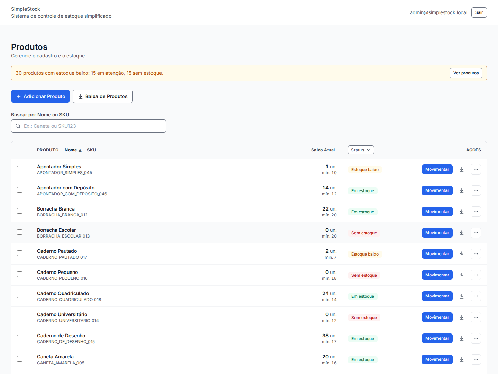
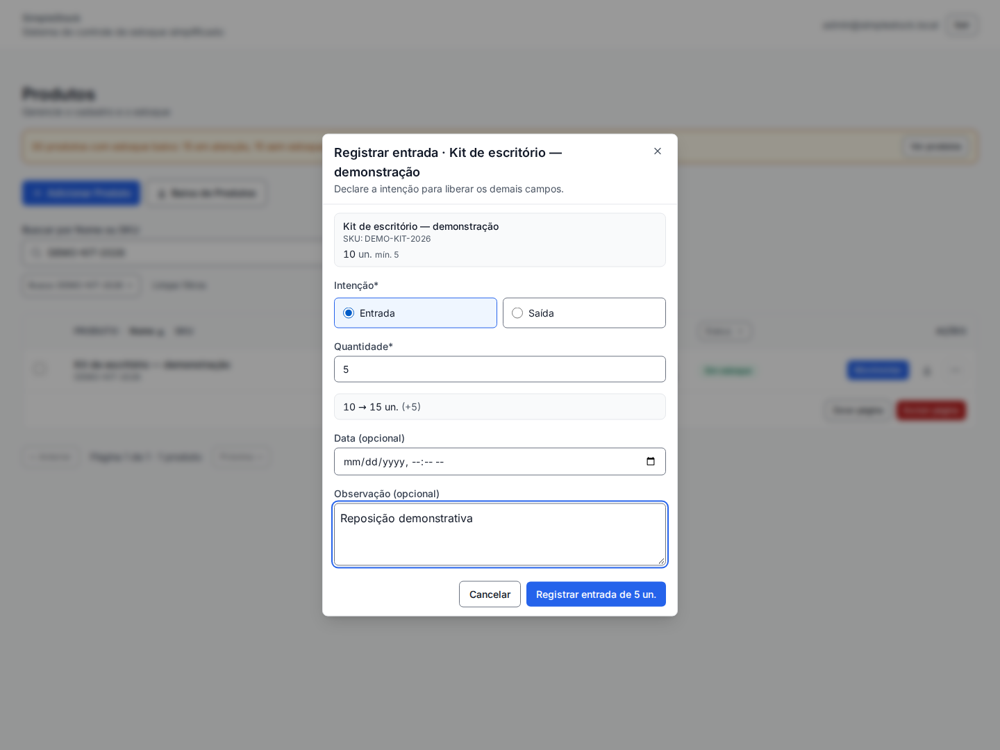
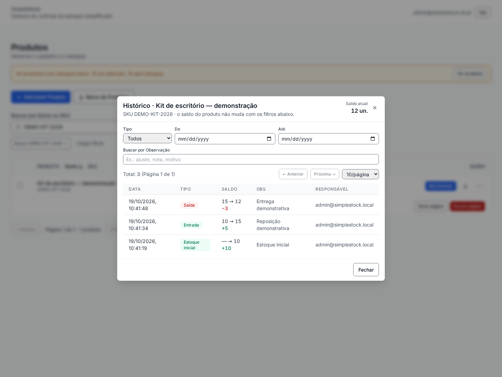

# SimpleStock — sistema de estoque

[](https://github.com/Leonardocmartins02/Sistema-Estoque-main/actions/workflows/ci.yml)

Aplicação full stack para cadastrar produtos, acompanhar saldos e registrar entradas,
saídas e ajustes de inventário. Cada movimentação feita pela aplicação registra
quantidade anterior, quantidade resultante e responsável, permitindo consultar como
um saldo mudou.

**[Ver apresentação e vídeo](https://portfolio-fullstack-delta-seven.vercel.app/projetos/simplestock)** ·
[Execuções do CI](https://github.com/Leonardocmartins02/Sistema-Estoque-main/actions) ·
[Executar localmente](#executar-localmente)

## Demonstração

As capturas e o vídeo usam dados fictícios em uma instalação local, com API e
PostgreSQL reais. O vídeo apresenta o cadastro de um produto, entrada, saída e
consulta do histórico. Não há, nesta versão, um ambiente público compartilhado para
alterar dados.







## Funcionalidades

- Login e proteção das operações de escrita.
- Cadastro, edição, busca e exclusão de produtos com SKU e estoque mínimo.
- Saldo inicial, entradas, saídas e ajuste de inventário.
- Baixa rápida de vários itens e histórico de baixas.
- Alertas de estoque baixo e filtros de status.
- Histórico de movimentações com rastreabilidade das operações da aplicação.
- Validação para impedir saldo negativo, inclusive sob saídas concorrentes.

## Arquitetura e decisões

| Camada | Tecnologias | Responsabilidade |
| --- | --- | --- |
| Interface | React 18, Vite, Tailwind, React Query | Consulta, formulários e atualização do estado remoto |
| API | Express, TypeScript, Zod | Autenticação, validação e operações de estoque |
| Persistência | Prisma, PostgreSQL | Produtos, usuários e movimentações |
| Qualidade | Vitest, Testing Library, Supertest, GitHub Actions | Verificações estáticas, integração, interface e build |

```text
React → API Express → StockService → Prisma → PostgreSQL
                       transação + bloqueio de linha
```

**Consistência do saldo.** O saldo é derivado das movimentações. O serviço de estoque
bloqueia a linha do produto com `SELECT … FOR UPDATE` dentro de uma transação,
recalcula o saldo, valida a operação e registra a movimentação. Isso impede duas
saídas simultâneas de aprovarem a mesma quantidade disponível.

**Estado remoto.** React Query concentra consultas, mutações e invalidação de cache.
Formulários usam React Hook Form e Zod; a API também valida as entradas recebidas.

**Testes com banco real.** As verificações de concorrência usam PostgreSQL separado
para testes, porque um mock não reproduz o comportamento dos locks do banco.

```text
packages/backend/   API, regras de estoque, migrations e testes de integração
packages/frontend/  aplicação React e testes de interface
packages/shared/    tipos compartilhados
```

## Executar localmente

Pré-requisitos: Node.js 22.13 ou superior na série 22, pnpm na versão declarada em
`package.json` e Docker com Compose (ou PostgreSQL local com dois bancos separados).
Use um banco de desenvolvimento vazio para seguir estes passos. Com nvm instalado,
`nvm install && nvm use` seleciona a versão exata de `.nvmrc` após o clone.

```bash
git clone https://github.com/Leonardocmartins02/Sistema-Estoque-main.git
cd Sistema-Estoque-main
corepack enable
pnpm install --frozen-lockfile
cp packages/backend/.env.example packages/backend/.env
```

Substitua `JWT_SECRET` em `packages/backend/.env` por um segredo local gerado com:

```bash
node -e "console.log(require('crypto').randomBytes(32).toString('hex'))"
```

Depois, prepare o banco e inicie a aplicação:

```bash
docker compose up -d --wait
pnpm --filter @simplestock/backend prisma:generate
pnpm --filter @simplestock/shared build
pnpm --filter @simplestock/backend db:migrate:deploy
pnpm --filter @simplestock/backend exec -- node --env-file=.env --import tsx src/seed.ts
pnpm dev
```

- Interface: <http://localhost:5173>
- API: <http://localhost:4000>
- Login **apenas para desenvolvimento**, criado pelo seed:
  `admin@simplestock.local` / `trocar-esta-senha-123`.
- O seed cria 50 produtos fictícios. Para outra credencial, defina
  `SEED_ADMIN_EMAIL` e `SEED_ADMIN_PASSWORD` antes de executar o seed. Ele não
  altera a senha de um usuário já existente.

O Vite encaminha `/api` para a API local. Para hospedar interface e API separadamente,
configure `VITE_API_BASE` e a origem da interface em `CORS_ALLOWED_ORIGINS`.

| Variável do backend | Uso |
| --- | --- |
| `DATABASE_URL` | Banco de desenvolvimento |
| `DATABASE_URL_TEST` | Banco exclusivo de testes; os testes removem dados |
| `JWT_SECRET` | Assinatura dos tokens |
| `CORS_ALLOWED_ORIGINS` | Origens autorizadas, separadas por vírgula |
| `PORT` | Porta da API, padrão 4000 |

O Compose cria os bancos de desenvolvimento e teste na primeira inicialização do
volume. Se usar PostgreSQL próprio, crie ambos e ajuste as duas URLs no `.env`.

## Verificações

Com PostgreSQL disponível e `DATABASE_URL_TEST` configurada:

```bash
pnpm -r run lint
pnpm -r run typecheck
pnpm --filter @simplestock/backend test
pnpm --filter @simplestock/frontend test
pnpm -r run build
```

O comando de testes do backend aplica as migrations ao banco de testes antes de
executar a suíte. O GitHub Actions executa essas mesmas etapas em pull requests e
pushes para `master`/`main`, usando PostgreSQL 16 como serviço isolado. Antes disso,
o pipeline instala o lockfile, gera o cliente Prisma e compila `packages/shared`: o
cliente e as declarações de tipos são necessários em um clone limpo.

## Limites e próximos passos

- A demonstração é gravada. `render.yaml` e a configuração de Netlify ainda não
  representam uma implantação pública pronta; os endereços de hospedagem precisam
  ser definidos antes de usá-los.
- O seed é uma ferramenta de desenvolvimento: suas movimentações antigas não
  possuem todos os campos de auditoria das operações criadas pela aplicação.
- A exclusão de produto também remove seu histórico; o sistema não é um livro
  imutável de auditoria.
- Existem melhorias de acessibilidade e rastreabilidade registradas na
  [revisão do ajuste de estoque](docs/features/ajuste-estoque/review.md).

A branch de apresentação é `master`. Trabalho em branches de desenvolvimento só
entra nela após revisão e verificações; a existência de um protótipo não indica que
esteja incluído na versão publicada.
